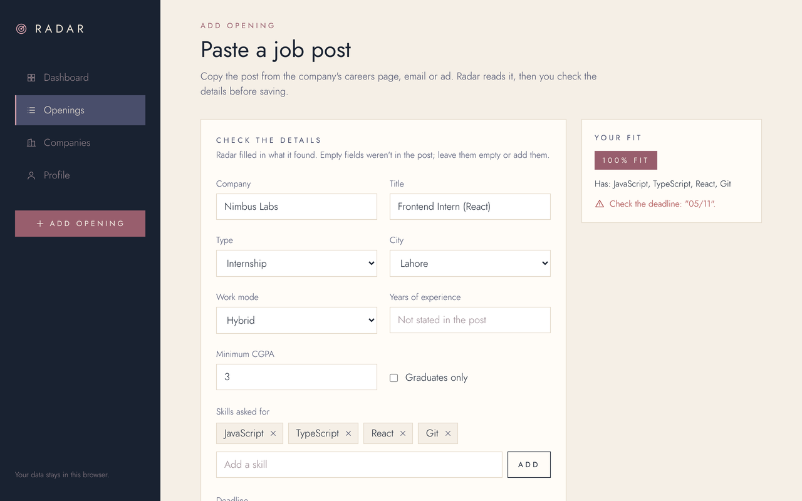
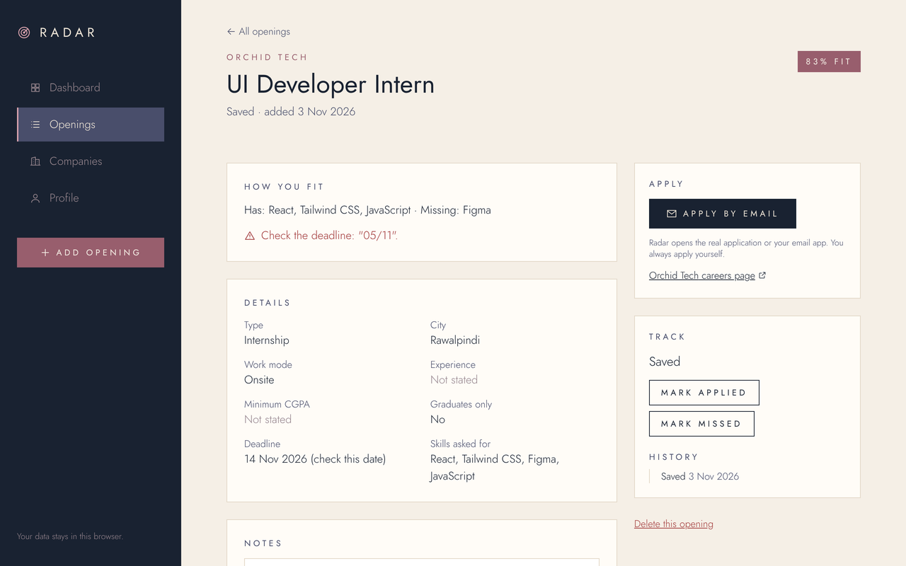
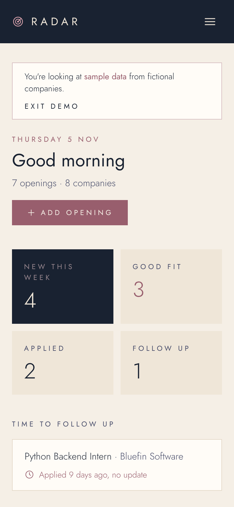

# Radar

**Every opening you find, and exactly how you fit.**

Radar is a job tracker for CS students in Pakistan. Paste an internship or job post you found on a software house's careers page, in an email or in a group. Radar reads it, scores it against your resume, explains the score, warns you about eligibility catches, and tracks your application until you hear back.

It runs **entirely in your browser**: no account, no server, no database. Your resume is read on your device and never uploaded.

**Live demo:** _link added after deployment_ · Click **Try the demo** to load sample data from fictional companies.


## Why I built it

Openings at smaller Pakistani software houses are spread across company websites, emails and private WhatsApp/Facebook groups. I kept losing track of which ones I was eligible for, what each asked for, and where I had already applied. Radar is the tool I wanted for that.

## What it does

| | |
|---|---|
| **Read a job post** | Paste the text → title, internship or job, city, onsite/hybrid/remote, skills, years of experience, minimum CGPA, graduates-only, deadline, apply link or email. Anything the post doesn't say is shown as **"Not stated"**, never guessed. |
| **Fit score with reasons** | "83% fit · Has: React, Tailwind CSS, JavaScript · Missing: Figma". Score = 70 for skills you have + 15 for internship/job match + 15 for experience. |
| **Eligibility warnings** | One line each: graduates only, a CGPA above yours, years of experience, a city you didn't pick, onsite when you want remote, an unclear or passed deadline. Warnings never hide an opening. |
| **Resume → skills** | Upload a PDF; skills are detected and you confirm, remove or add them. Scanned, password-protected or damaged PDFs get a clear message and manual entry. |
| **Tracker** | Saved → Applied → Interview → Offer / Rejected, plus Missed. Every change is dated, notes are kept per opening, and you get a nudge after 7 days with no update. Past deadlines move to Missed. |
| **Dashboard** | New this week, good fits, applied, follow-ups, best-fit openings and the companies you watch. |
| **Openings list** | Search plus combined filters (city, work mode, type, fit, status, new this week), sorting, and **CSV export** that opens in Excel. |
| **Companies** | Add by hand, edit (including your own careers-page link), remove, or **import a CSV**: bad rows are listed with the reason, duplicates are skipped, and BPOs, call centres and marketing-only firms are filtered out. |

| Paste a post | Opening detail and tracker | On a phone |
|---|---|---|
|  |  |  |

## Run it locally

You need **Node.js 22+**. No keys, accounts or database.

```bash
git clone https://github.com/TechnicalSamia18/radar-frontend.git
cd radar-frontend
npm ci          # installs the exact versions in package-lock.json
npm run dev     # http://localhost:3000
```

The first run downloads two Google Fonts once (needs internet). Then open the app and click **Try the demo**, or go to **Profile** and upload your resume.

| Command | What it does |
|---|---|
| `npm test` | 112 unit tests (Vitest): reading posts, dates, fit score, CSV import/export, storage, validation |
| `npm run test:e2e` | 21 page tests in Chromium at desktop and phone size (Playwright). First time: `npx playwright install chromium` |
| `npm run lint` | ESLint |
| `npm run build` | Production build (also type-checks) |

Every push runs lint, unit tests, the build and the page tests on GitHub Actions (`.github/workflows/ci.yml`).

## How it's built

**Stack:** Next.js 16 (App Router, TypeScript) · React 19 · Tailwind CSS 4 · Zod · unpdf (pdf.js) · chrono-node · Vitest · Playwright. Every version is pinned; see [`docs/DEPENDENCIES.md`](docs/DEPENDENCIES.md) for why each one was chosen and its vulnerability scan.

```
src/
  app/            pages: home, how-it-works, about, dashboard, openings, openings/new,
                  openings/detail, companies, profile, demo
  components/     shared UI: navigation, opening card, fit badge, form field, data gate
  lib/
    data/         schema (Zod), repository (localStorage), store (React hook), demo data
    openings/     extract (read a post), match (fit + warnings), tracker, filter, export
    companies/    CSV import, add/edit/remove
    resume/       PDF → text → skills
    skills/       skills dictionary + detector
```

- **Logic is separate from UI.** Everything in `src/lib` is a plain function with tests: give it state, get new state back. Components only display and call these.
- **One door to the data.** All reads and writes go through `RadarRepository` (`src/lib/data/repository.ts`). Today it's localStorage; a server version could replace it without touching any component.
- **Stored data is never trusted.** Every load is checked against a Zod schema. Damaged or hand-edited data shows a clear error with a "Start fresh" option instead of crashing.
- **Shared state without a library.** `useRadar()` is built on React's `useSyncExternalStore`, so every component updates together, even across open tabs.

### Security and privacy

- **Pasted posts are untrusted.** They're rendered as plain text (React escapes them); a `<script>` in a post shows up as text and never runs (tested). Only `http(s)` links are kept, so `javascript:` links are rejected.
- **CSV injection.** On export, cells starting with `=`, `+`, `-`, `@`, tab or CR get a leading apostrophe, so a malicious post can't plant an Excel formula.
- **Validation everywhere.** Every form and every stored value goes through a strict Zod schema: invalid input is rejected with a message, never silently "fixed".
- **Privacy.** No server, no analytics, no account. The resume PDF is read in the browser and discarded; only the skills you confirm are saved.

### Accessibility

Keyboard-usable throughout, with a "Skip to content" link, visible focus outlines, labelled form fields with error messages next to them, `aria-current` on navigation, `aria-live` status messages, the radar animation turned off for reduced motion, and layouts tested at 375 px and 1280 px.

## Deliberately not implemented

| Not built | Why |
|---|---|
| **Finding companies and openings automatically** (directory import, careers-page finder, daily checks) | That's backend work: crawling sites, respecting robots.txt, scheduled jobs. This is a frontend project, so you bring the openings. The full plan is in [`docs/PRD.md`](docs/PRD.md) for a later version. |
| **LinkedIn, Indeed, Facebook or WhatsApp integration** | No public job APIs, and their terms prohibit scraping and bots. |
| **Auto-filling or auto-submitting applications** | Every form is different, many have CAPTCHAs, and a wrong application sent in your name can't be taken back. Radar opens the real application; you apply yourself. |
| **Reading image or PDF job ads (OCR)** | Adds errors and complexity. Image ads are saved with their link and shown as "Fit unknown". |
| **AI extraction** | Would need a paid API key and could invent details. The rules-based reader says "Not stated" instead of guessing. |
| **Accounts and sync between devices** | Would need a server and storing personal data. Everything stays in one browser; export to CSV to back up. |
| **Excel (.xlsx) export** | CSV opens in Excel and needs no extra library. |
| **Merging duplicate openings** | Rare when you add openings yourself; a duplicate simply shows twice. |
| **Email or push notifications** | The dashboard's follow-up list covers it for v1. |

## Known limitations

- Data lives in one browser. Clearing site data or switching devices starts fresh; use **Export CSV** as a backup.
- The post reader uses rules, not AI. Unusual layouts may need a few fields filled in by hand on the "Check the details" step.
- Dates are read day-first (20/11 = 20 November). Dates that could mean two things, like 05/11, are flagged for you to check.

## Project notes

Decisions, risks and progress are in [`docs/`](docs/): [`PRD.md`](docs/PRD.md) (full product plan; §14 is this version), [`DECISIONS.md`](docs/DECISIONS.md), [`RISKS.md`](docs/RISKS.md), [`PROJECT_STATE.md`](docs/PROJECT_STATE.md). The commit history shows the build step by step.
