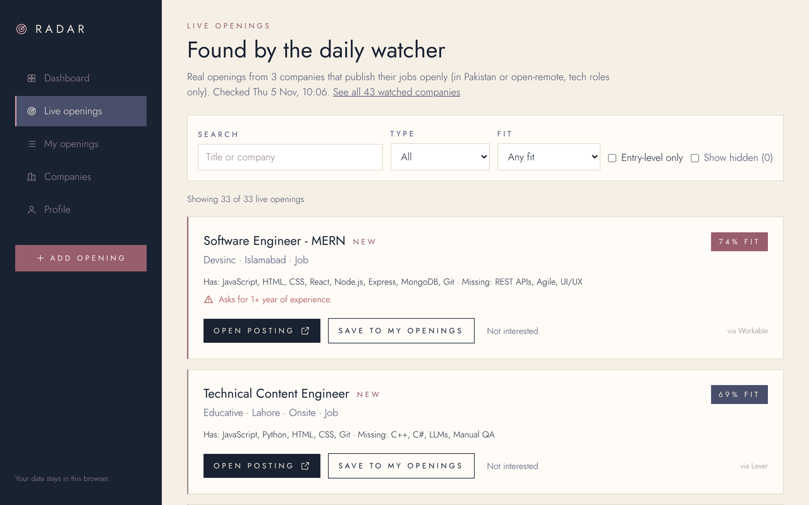
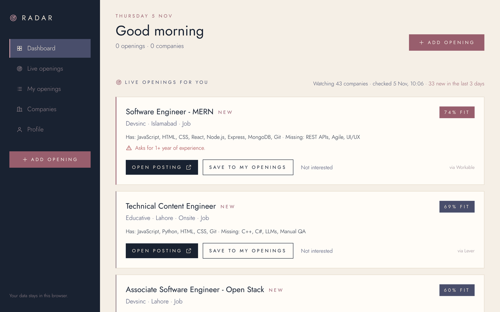
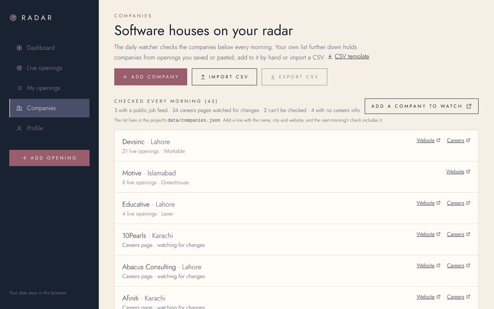
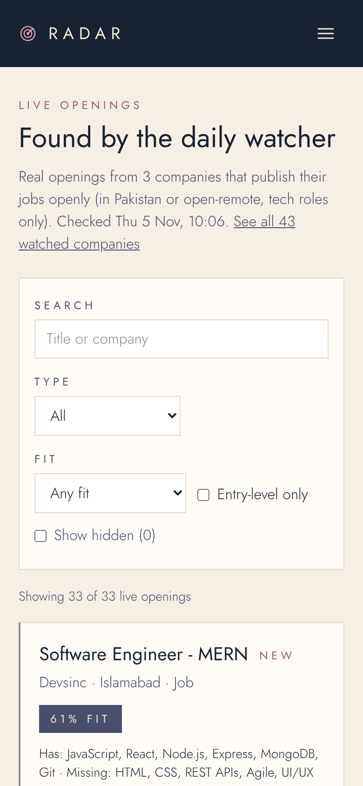

# Radar

**Real openings from Pakistani software houses, and exactly how you fit.**

Radar checks Pakistani software houses every morning. When a company publishes its jobs openly, Radar brings in the real openings, scores each one against your resume, explains the score, warns you about eligibility catches, and tracks your application until you hear back. Openings you find anywhere else can be pasted in and get the same treatment.

The website runs **in your browser**: no account, no server, no database. Your resume is read on your device and never uploaded. The daily check is a small free job on GitHub Actions.

**Live site:** [radar-frontend-pi.vercel.app](https://radar-frontend-pi.vercel.app): open **Live openings** for today's real openings, or **Profile** to add your resume.

**Quick start** (Node.js 22+, no keys or accounts):

```bash
npm ci && npm run dev   # then open http://localhost:3000
```

**Why it's built this way:** [DECISION-RECORD.md](DECISION-RECORD.md) covers the three decisions that would be hardest to undo, what each one costs, and where they've proved awkward.



## Why I built it

Internships and junior roles at Pakistani software houses are spread across company websites, hiring platforms, emails and private WhatsApp/Facebook groups. I kept missing them, losing track of which ones I was eligible for, and forgetting where I'd applied. Radar is the tool I wanted for that.

## What it does

| | |
|---|---|
| **Live openings, checked every morning** | A watcher visits each company on the list. If the company publishes jobs through a hiring platform with an open feed (Workable, Greenhouse, Lever, Ashby…), Radar reads the openings directly: real titles, cities and apply links. It keeps tech roles in Pakistan or open-remote. |
| **Careers-page alerts** | For companies with a plain careers page, Radar watches the page and tells you when it changes ("Folio3's careers page changed. Have a look"). It doesn't guess what the new jobs are. |
| **Fit score with reasons** | "74% fit · Has: React, Node.js, Express, MongoDB · Missing: REST APIs". Senior, lead and manager roles are capped at a low fit, because they aren't realistic for a student. |
| **Eligibility warnings** | One line each: graduates only, a CGPA above yours, years of experience, a senior role, a city you didn't pick, onsite when you want remote, an unclear or passed deadline. Warnings never hide an opening. |
| **Resume → skills** | Upload a PDF; skills are detected in your browser and you confirm, remove or add them. Scanned, password-protected or damaged PDFs get a clear message and manual entry. |
| **Paste anything else** | Found an opening on LinkedIn or in a group? Paste it. Radar reads the title, type, city, skills, experience, CGPA, deadline and how to apply, shows **"Not stated"** for anything missing, and flags dates that could mean two things (05/11). |
| **Tracker** | Saved → Applied → Interview → Offer / Rejected, plus Missed. Every change is dated, notes are kept per opening, you get a nudge after 7 days with no reply, and past deadlines move to Missed. |
| **Filters and export** | Search plus combined filters, an entry-level-only switch, hide openings you're not interested in (with undo), and a CSV export that's safe to open in Excel. |

| Dashboard | Watched companies | On a phone |
|---|---|---|
|  |  |  |

## How much it finds (measured, 5 Nov 2026)

I tested this before building it ([`docs/coverage/results.md`](docs/coverage/results.md)). Of **43** Pakistani software houses:

- **3** publish their jobs through an open hiring-platform feed (Devsinc on Workable, Motive on Greenhouse, Educative on Lever). On the first day they gave **50 openings, 33 of them tech roles in Pakistan or open-remote**, including entry-level and associate roles.
- **34** have a careers page Radar watches for changes.
- **4** have no careers information online, and **2** couldn't be checked (one blocks automated visitors).

So Radar doesn't see every opening in Pakistan. Many companies only post on LinkedIn or in groups, which Radar deliberately doesn't scrape. It reliably catches what's published openly, alerts you when the other careers pages change, and anything else can be pasted in. Each company added to the list is checked from the next morning.

## Run it locally

You need **Node.js 22+**. No keys, accounts or database.

```bash
git clone https://github.com/TechnicalSamia18/radar-frontend.git
cd radar-frontend
npm ci          # installs the exact versions in package-lock.json
npm run dev     # http://localhost:3000
```

The first run downloads two Google Fonts once (needs internet). The live openings in `public/feed/` are the latest ones the watcher saved to the repo. To run the watcher yourself: `node scripts/watcher/watch.mjs` (about a minute).

| Command | What it does |
|---|---|
| `npm test` | 140 unit tests (Vitest): watcher parsing and filters, robots.txt, change detection, reading posts, dates, fit score, CSV import/export, storage |
| `npm run test:e2e` | 33 page tests in Chromium at desktop and phone size (Playwright), using a fixed copy of the feed. First time: `npx playwright install chromium` |
| `npm run lint` | ESLint |
| `npm run build` | Production build (also type-checks) |

GitHub Actions runs two workflows: **CI** on every push (lint, unit tests, build, page tests) and the **Daily watcher** every morning at 06:17 Pakistan time.

## How it's built

**Stack:** Next.js 16 (App Router, TypeScript) · React 19 · Tailwind CSS 4 · Zod · unpdf (pdf.js) · chrono-node · Vitest · Playwright · GitHub Actions. Every version is pinned; [`docs/DEPENDENCIES.md`](docs/DEPENDENCIES.md) explains each one and its vulnerability scan.

```
data/companies.json      the companies the watcher checks
scripts/watcher/         the daily watcher (plain Node, no dependencies) + its tests
public/feed/             what the watcher found: openings.json, companies.json
src/
  app/                   pages: home, how-it-works, about, dashboard, live, openings,
                         openings/new, openings/detail, companies, profile, demo
  components/            navigation, live card, opening card, fit badge, form field, data gate
  lib/
    feed/                load + validate the watcher's files, convert, save/hide
    data/                schema (Zod), repository (localStorage), store (React hook), demo data
    openings/            read a post, fit + warnings, tracker, filters, CSV export
    companies/           CSV import, add/edit/remove
    resume/, skills/     PDF → text → skills
```

```
 GitHub Actions (06:17 daily)                         Your browser
 ┌──────────────────────────────┐   commits   ┌─────────────────────────────────┐
 │ scripts/watcher/watch.mjs    │ ──────────▶ │ /feed/openings.json  ─┐         │
 │  · robots.txt, honest agent  │ public/feed │ /feed/companies.json  ├─ Zod ─▶ │
 │  · hiring-platform feeds     │  (Vercel    │                        │  fit    │
 │  · careers-page fingerprints │  redeploys) │ your profile, saved ───┘  score  │
 └──────────────────────────────┘             │ openings (localStorage)          │
                                              └─────────────────────────────────┘
```

- **Logic is separate from UI.** Everything in `src/lib` and `scripts/watcher/lib.mjs` is plain functions with tests. Components only display and call them.
- **One door to your data.** All reads and writes go through `RadarRepository` (`src/lib/data/repository.ts`, localStorage today), so a server could replace it without touching components.
- **Nothing read from outside is trusted.** Stored data and the watcher's files are checked with Zod on every load. A damaged or tampered file shows a clear error ("Start fresh", "Try again") instead of bad data.
- **The watcher can't take the site down.** One company failing never stops the others, and if the run crashes, what was already checked is still saved. A site that can't be reached three days running is flagged "check the link".

### Responsible checking

- `robots.txt` is read for every site and respected; if a site asks automated tools to stay away, Radar does and says so.
- Each request names Radar and links to this repo. There's a pause between requests to the same site, and each company is checked once a day.
- Hiring platforms are read through their **official public job feeds**, the same data their own careers pages show.
- No logins, no getting around blocks, and no LinkedIn, Indeed, Facebook or WhatsApp.

### Security and privacy

- **Text from outside is untrusted.** Job descriptions and pasted posts are rendered as plain text (React escapes them): a `<script>` in a post shows as text and never runs (tested). Only `http(s)` links are kept.
- **CSV injection.** Exported cells starting with `=`, `+`, `-`, `@`, tab or CR get a leading apostrophe, so a malicious post can't plant an Excel formula.
- **Validation everywhere.** Every form, every stored value and every feed file goes through a strict Zod schema: invalid input is rejected with a message, not silently fixed.
- **Privacy.** No server, no analytics, no account. Your resume is read in your browser and discarded; only the skills you confirm are saved.

### Accessibility

Keyboard-usable throughout, with a "Skip to content" link, visible focus outlines, labelled form fields with error messages next to them, `aria-current` on navigation, `aria-live` status messages (saved, hidden, undo), the radar animation turned off for reduced motion, and layouts tested at 375 px and 1280 px.

## Deliberately not implemented

| Not built | Why |
|---|---|
| **LinkedIn, Indeed, Facebook or WhatsApp** | No public job APIs, and their terms prohibit scraping and bots. Paste those openings instead. |
| **Guessing jobs from plain careers pages** | Every site is laid out differently and guesses would be wrong. Radar alerts you when a page changes and shows the role names it spotted as a hint. |
| **Automatic company discovery** (PSEB directory, Google Places) | PSEB's terms for automated use are unclear, and Google Places needs a paid account. The list is curated, and adding a company is one line. |
| **Auto-filling or auto-submitting applications** | Every form is different, many have CAPTCHAs, and a wrong application sent in your name can't be taken back. Radar opens the real posting; you apply yourself. |
| **Reading image or PDF job ads (OCR)** | Adds errors. Pages with an image job ad are flagged instead. |
| **AI extraction** | Would need a paid API key and could invent details. The rules say "Not stated" instead of guessing. |
| **Accounts and sync between devices** | Would need a server holding personal data. Your data stays in one browser; export to CSV to back up. |
| **Email or push notifications** | The dashboard's "new", "changed" and "follow up" lists cover it for v1. |
| **Excel (.xlsx) export, merging duplicate openings** | CSV opens in Excel; duplicates are rare and simply show twice. |

## Known limitations

- Coverage depends on companies publishing jobs openly (see the numbers above).
- Your saved data lives in one browser. Clearing site data or switching devices starts fresh. Use **Export CSV** on My openings as a backup, and **Import CSV** to restore it in another browser.
- Fit scores come from a skills dictionary, not AI. A post that names few skills gets a cautious score.
- Dates are read day-first (20/11 = 20 November). Dates that could mean two things are flagged for you to check.

## Project notes

[`DECISION-RECORD.md`](DECISION-RECORD.md) explains the three biggest decisions and their costs. [`docs/`](docs/) holds the product plan ([`PRD.md`](docs/PRD.md)), decisions ([`DECISIONS.md`](docs/DECISIONS.md)), risks, the coverage check ([`coverage/results.md`](docs/coverage/results.md)) and progress ([`PROJECT_STATE.md`](docs/PROJECT_STATE.md)). The commit history shows the build step by step, including the moment the project changed course from paste-only to live openings.
